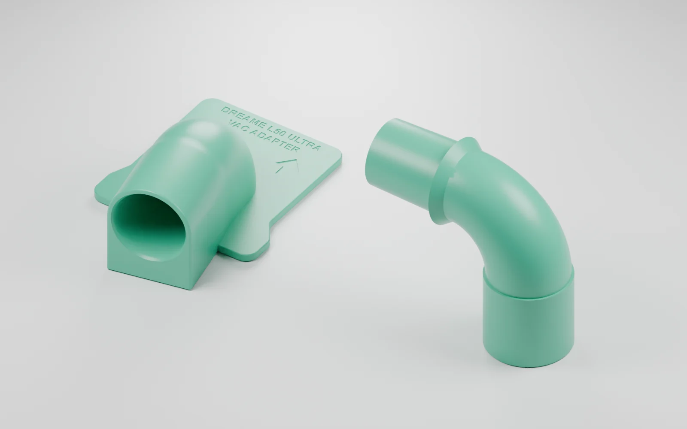
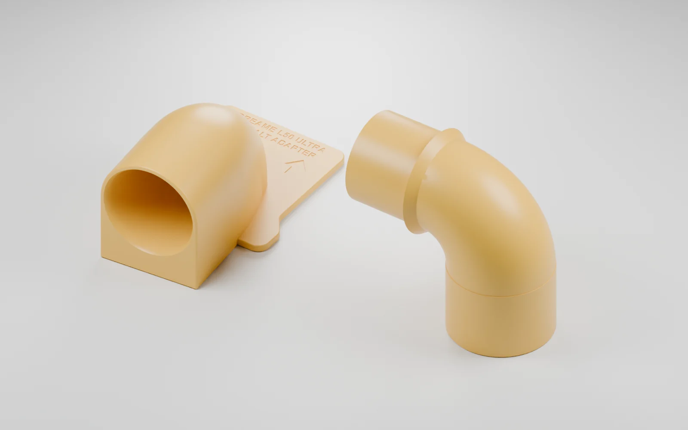

# Dreame L50 Ultra → wet/dry vacuum adapters

Parametric build123d models for routing a Dreame L50 Ultra dock's evacuation
path into an external wet/dry vacuum, without cutting the dock. There are two
vacuum-specific versions:

- **Stanley SL18129** — based on an approximately 30.75 mm hose connector.
- **DeWalt DXV05P-QT** — based on a measured cuff taper: 44.77 to 45.77 mm
  outside diameter over 62.24 mm.

Each version has a dock-side card adapter and a separate plug-in 90-degree
elbow. The second bend turns the hose connection downward.

## Models

| Vacuum | Dock adapter | Matching plug-in elbow |
| --- | --- | --- |
| Stanley SL18129 | [STL](models/hose-adapter-rev5.stl) · [STEP](models/hose-adapter-rev5.step) | [STL](models/stanley-to-stanley-90-elbow.stl) · [STEP](models/stanley-to-stanley-90-elbow.step) |
| DeWalt DXV05P-QT | [STL](models/hose-adapter-rev5-dewalt-measured.stl) · [STEP](models/hose-adapter-rev5-dewalt-measured.step) | [STL](models/dewalt-to-dewalt-90-elbow.stl) · [STEP](models/dewalt-to-dewalt-90-elbow.step) |

### Stanley



### DeWalt



These are renders of the actual model meshes, not photographs of finished parts.
The complete card-and-elbow assemblies have not been validated for sealing,
retention, dock-cover clearance or reliable debris evacuation. A socket coupon
and earlier card fit tests were successful; that does not establish those other
properties. The printed male elbow connections need their own fit checks.

## Edit and regenerate

Install [uv](https://docs.astral.sh/uv/), then:

```sh
uv sync --locked
uv run python cad/export_models.py
```

The source is under [cad/build123d/](cad/build123d/). The main entry points are
`rev5_full_adapter.py` for Stanley, `dewalt_rev5_adapter.py` for DeWalt, and
`dewalt_addon_elbow.py` for the separate elbows. `elbow_variants.py` also
contains a Stanley-to-DeWalt variant and slicing orientations.

Dimensions are in millimetres. STEP files retain solid geometry; STL files
are meshes. The elbow's exported position is a starting position for slicing,
not a claim that it prints without supports. See the
[development notes](DEVELOPMENT.md#elbow-variants-and-slicing-study-2026-10-04)
for the recorded slicing work.

Optional model renders require Blender:

```sh
blender --background --python cad/render_models.py
```

PNG renders are written to the ignored `cad/exports/blog/` directory.

## Prototype status and background

The goal is to handle dense dog hair that the stock dock struggles to empty.
The intended path is robot → existing dock evacuation path → printed adapter
and hose → external wet/dry vacuum. The design remains removable.

Suction level, relief/air bleed, sealing and supervised emptying tests remain
part of the prototype work. More suction is not automatically suitable for the
robot's bin, flaps and seals. Any automation needs reliable shutoff and a motor-
rated switching device. The Home Assistant relay sequence was tested separately
from dust capture through the adapter.

Nelson supplied the idea, measurements and physical fit feedback. Codex did the
CAD implementation and helped with the automation and documentation.

The [development notes](DEVELOPMENT.md) preserve the revisions, measurements,
fit reports and remaining questions. [Measurement notes](measurements/) record
the interface provenance; the supplied third-party reference archive is not
redistributed here.
